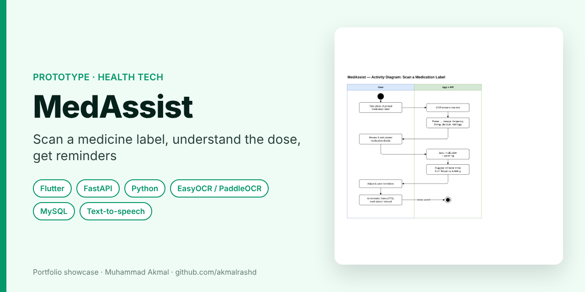
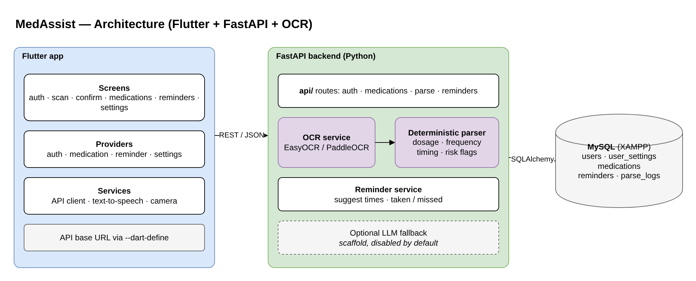
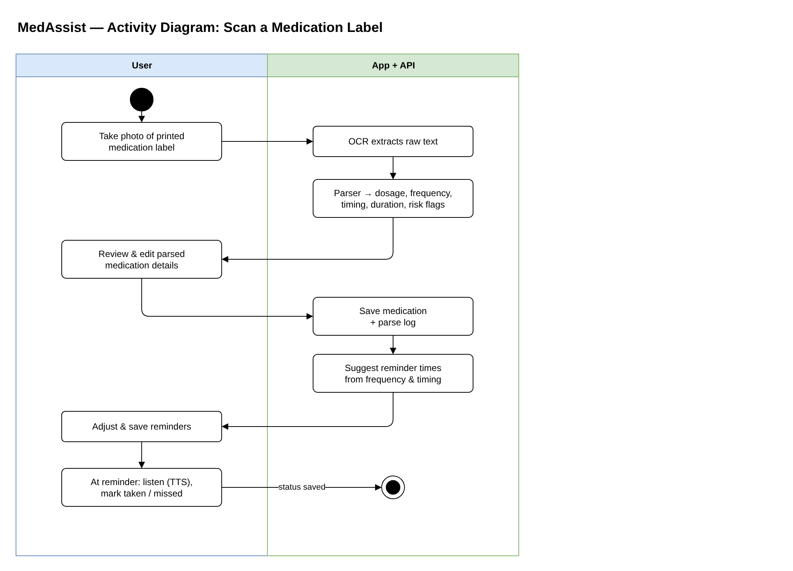
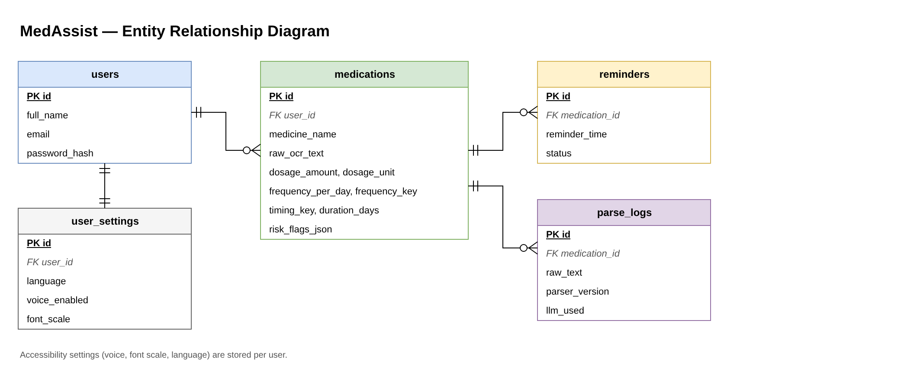

# MedAssist: Medication Label Assistant

> **Portfolio showcase** of a prototype. Source code is private.

**Type:** Prototype · **Period:** April 2026

   

---

## The idea

Medicine labels are small, and instructions such as *"Ambil 1 biji, 3 kali sehari selepas makan"* are easy to misread. MedAssist reads a **printed medication label** with OCR, turns it into structured dose, frequency and timing, lets the user check and correct it, then sets up **reminders**. It can read the guidance aloud with text-to-speech.

## Features

- OCR scan of printed clinic and pharmacy labels (EasyOCR / PaddleOCR)
- **Deterministic parser** for dosage, frequency, timing, duration and risk flags (BM label phrases)
- Edit-before-save confirmation; medication list and details
- Reminder suggestions from frequency and timing; mark taken or missed
- Accessibility settings per user: language, voice on/off, font scale

## System design

### Architecture

### Activity diagram: scan a medication label

### Entity relationship diagram

## Design decisions

- **Rules first, AI optional:** the parser is deterministic and testable; an LLM fallback exists only as a disabled scaffold, so health information is never invented by a model.
- **Every parse is logged** (`parse_logs` with parser version), so wrong readings can be traced and the parser improved.
- **Local-first:** runs on XAMPP MySQL and a local FastAPI server, and the app's API URL is configurable at build time.

## Contact

**Muhammad Akmal bin Mohd Rashid**: Software Engineering student, UMPSA.  
Open to a 6-month internship (22 February to 7 August 2027).  
📧 work.akmalrashd@gmail.com · 💼 [linkedin.com/in/akmalrashd](https://www.linkedin.com/in/akmalrashd)
